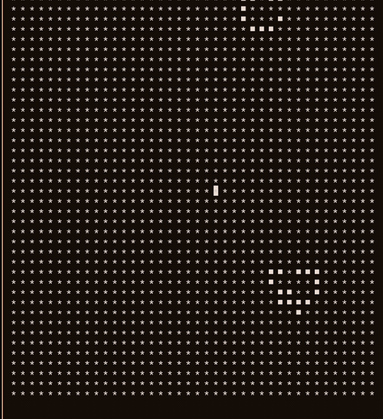

# Игра «Жизнь» Конвея на Go



Консольная реализация клеточного автомата «Игра „Жизнь“», написанная на Go. На поле размером `N × M` клетки обновляются по классическим правилам Конвея.

## Возможности

- Настраиваемый размер игрового поля.
- Предустановленные фигуры, которые можно разместить на поле:
  1. Квадрат
  2. Глайдер
  3. Блинкер
  4. R-пентамино
  5. Жёлудь
- Несколько фигур можно выбрать за один запуск; координаты размещаются случайно.
- Поле тороидальное: его противоположные края соединены.
- Расчёт поколений выполняется параллельно с помощью пула рабочих горутин.
- Симуляция выводит 1200 поколений.

## Правила

Каждая клетка имеет восемь соседей:

- Живая клетка остаётся живой, если у неё два или три живых соседа.
- Мёртвая клетка становится живой, если у неё ровно три живых соседа.
- Во всех остальных случаях клетка становится или остаётся мёртвой.

## Требования

- Go **1.24.4** или новее.

## Запуск

Из корневой папки проекта выполните:

```bash
go run .
```

Программа запросит количество строк `N` и столбцов `M`, затем номера фигур. Введите один или несколько номеров от `1` до `5`; введите `0`, чтобы завершить выбор и начать симуляцию.

Например, чтобы запустить поле `40 × 40` только с Блинкером:

```text
N: 40
M: 40
3
0
```

Обозначения в выводе: `■` — живая клетка, `*` — мёртвая.

## Проверка

```bash
go test ./...
```
